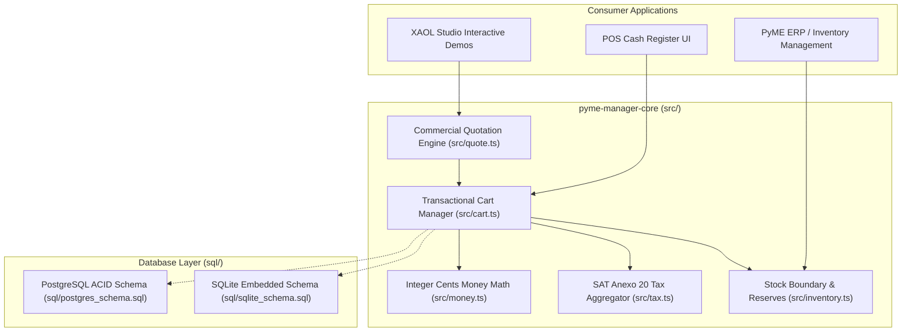
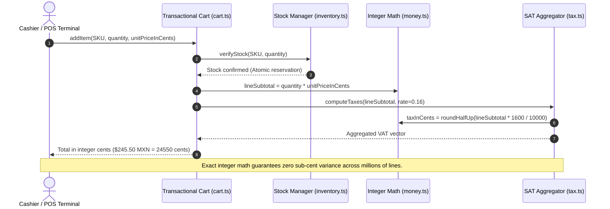

# 🏛️ PyME Manager Core Architecture & System Topology

Deterministic, integer-cents financial engine and transactional retail backend for Mexican small and medium enterprises (PyMEs). Built with TypeScript, PostgreSQL / SQLite relational schemas, and Mexican SAT Anexo 20 fiscal compliance. Complete zero-dependency runtime tested via Node.js native test runner.

---

## 1. Technology Stack

| Layer | Technology | Details |
| :--- | :--- | :--- |
| **Language & Runtime** | TypeScript 5 (Strict) / Node.js | Zero external runtime dependencies; pure compiled JavaScript |
| **Arithmetic Engine** | Integer Cents Arithmetic | Eliminates IEEE 754 floating-point drift across bulk transactions |
| **Database Schemas** | PostgreSQL 16 & SQLite 3 | Relational DDL with CHECK constraints, foreign keys, and indexes |
| **Fiscal Rules** | Mexican SAT Anexo 20 | Multi-rate VAT aggregator (16%, 8% border, 0%, exempt) and retentions |
| **Testing** | Node.js Native Test Runner | Fast, zero-dependency testing (`node --test`) without framework bloat |

---

## 2. System Topology & Component Graph



---

## 3. Financial Transaction Lifecycle (Zero Float Drift)



---

## 4. Directory Structure & Module Breakdown

```
pyme-manager-core/
├── src/                      # Core TypeScript source code
│   ├── index.ts              # Unified library export barrel
│   ├── money.ts              # Integer cents conversion, formatting, basis points
│   ├── tax.ts                # SAT Anexo 20 VAT transfers (16%, 8%, 0%) & retentions
│   ├── cart.ts               # POS cart session with multi-tier pricing (Retail, Wholesale)
│   ├── inventory.ts          # Atomic SKU stock checking and deficit guards
│   ├── quote.ts              # Formal commercial quotation generator
│   └── types.ts              # Core domain models (Item, Cart, TaxSummary, Quote)
├── sql/                      # Relational database schemas
│   ├── postgres_schema.sql   # Production PostgreSQL DDL with table constraints
│   └── sqlite_schema.sql     # Local embedded SQLite DDL for offline point-of-sale
├── tests/                    # Native Node.js test suite (`node --test`)
│   ├── money.test.mjs        # Float-to-cents rounding and formatting tests
│   ├── tax.test.mjs          # SAT Anexo 20 tax rate combination assertions
│   └── cart.test.mjs         # Multi-tier pricing and stock boundary validation
├── dist/                     # Compiled JavaScript and TypeScript declaration files
├── tsconfig.json             # TypeScript compiler settings
└── package.json              # Library manifest and build scripts
```
